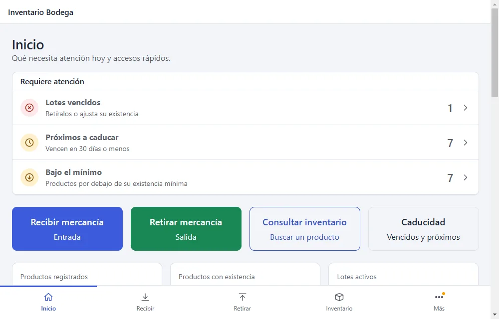
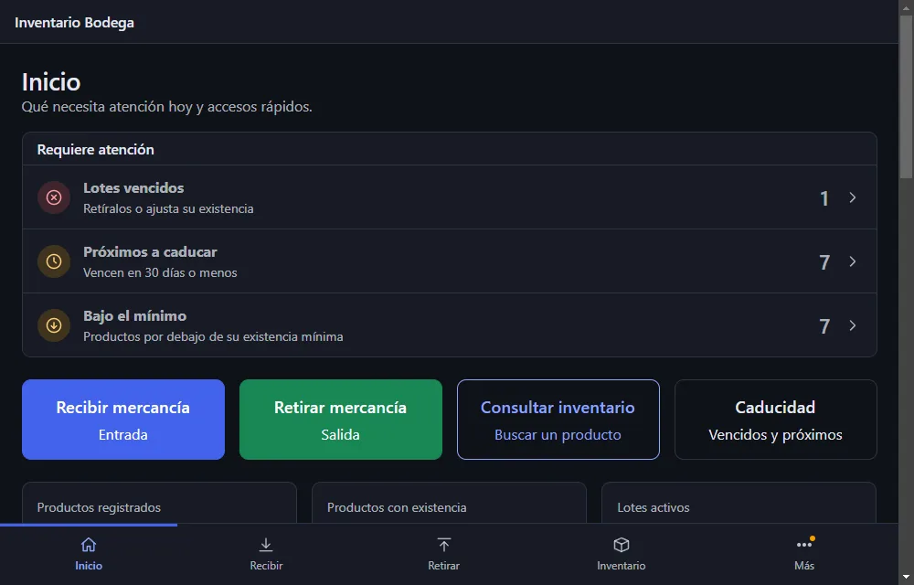
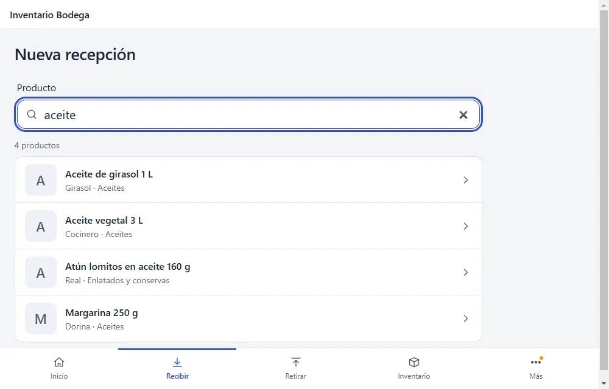
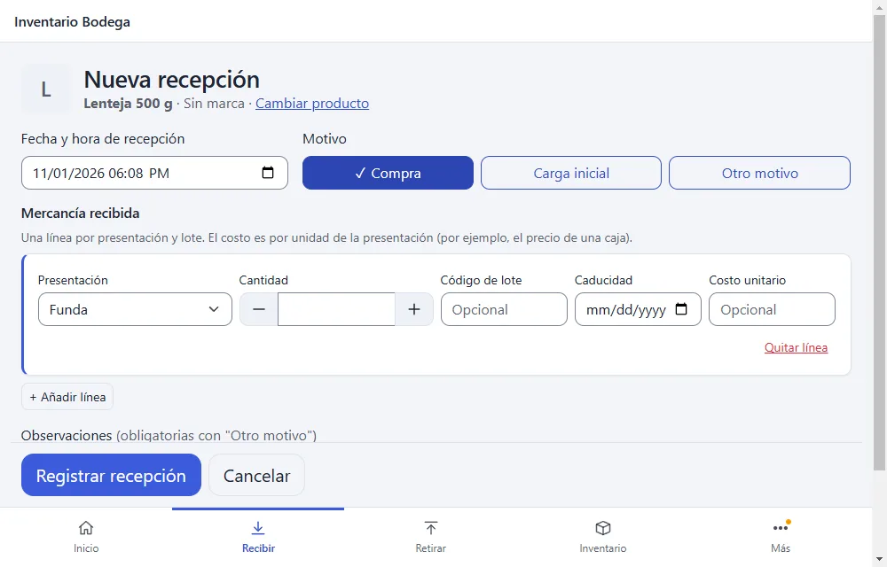
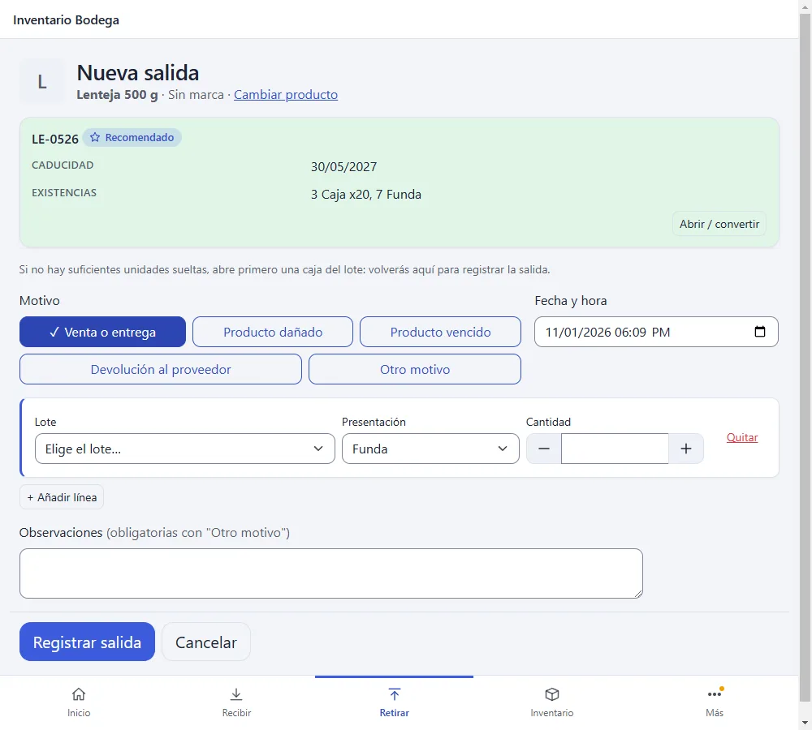
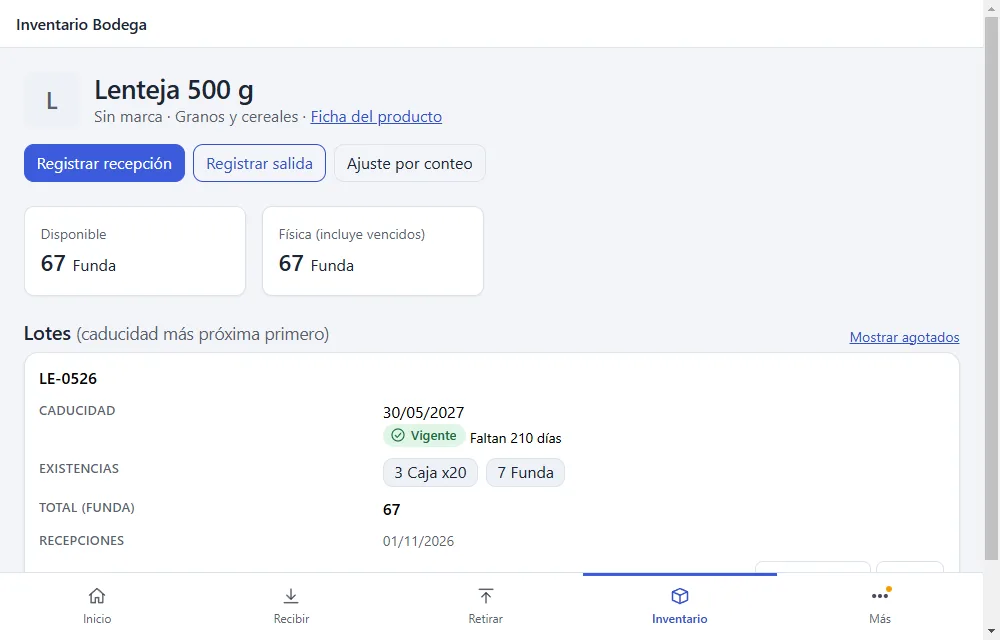
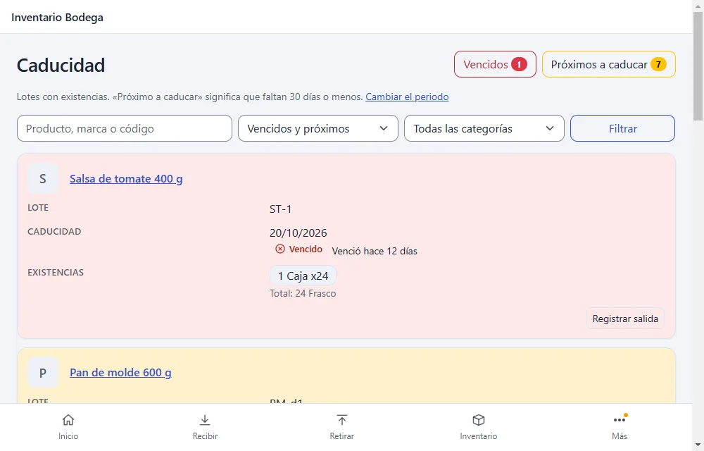
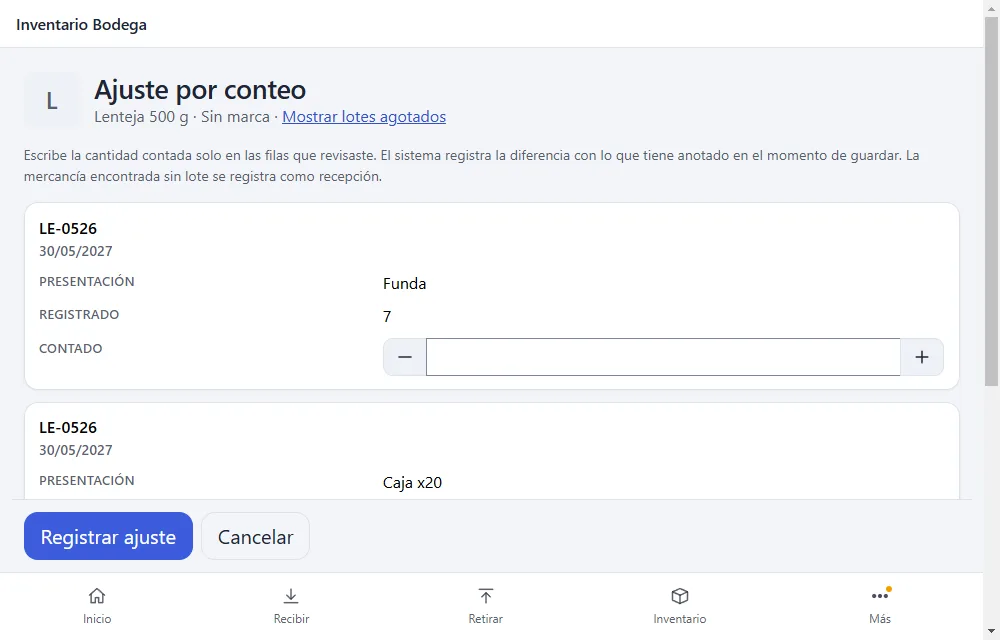
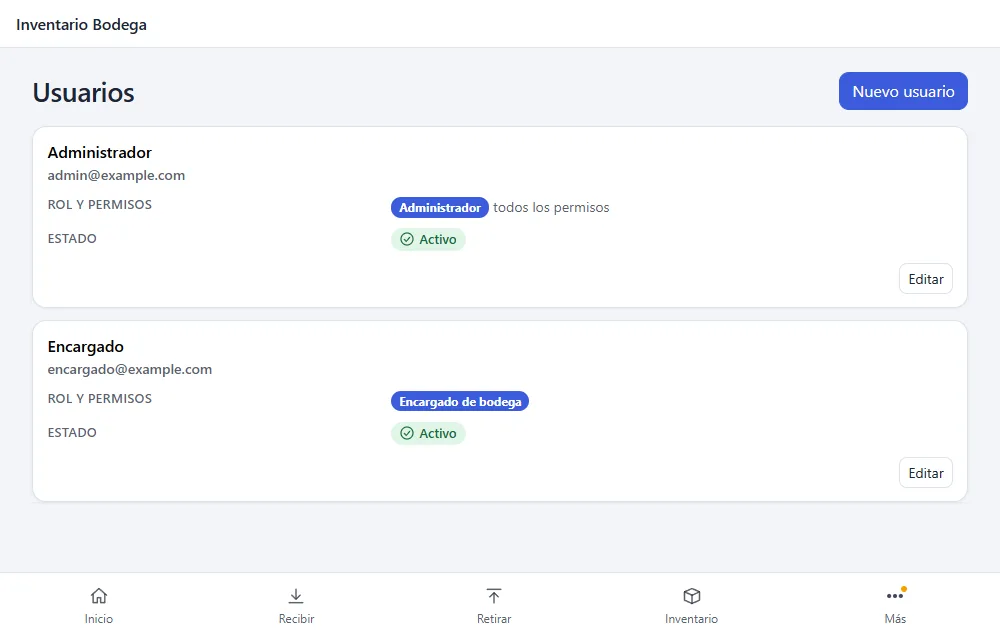
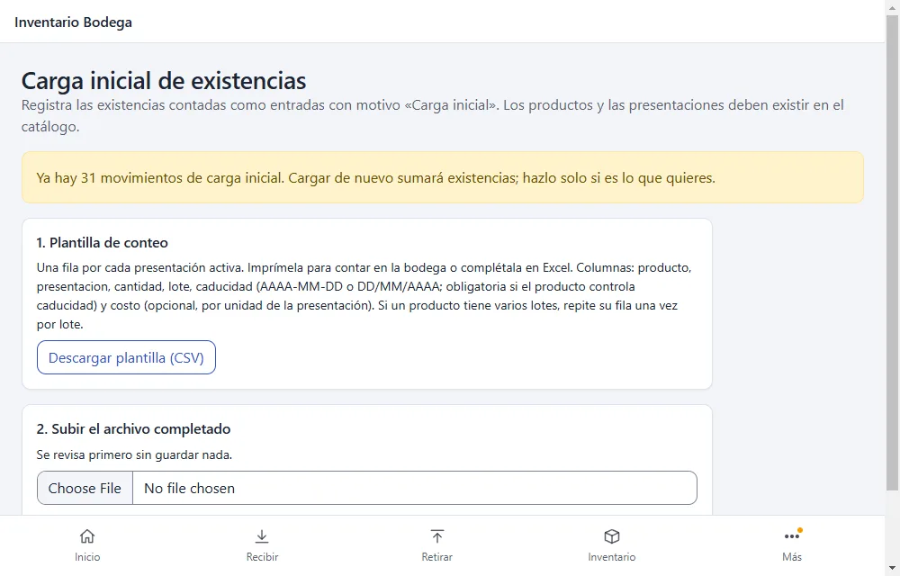

# Guía de uso

Esta guía explica, paso a paso, cómo se trabaja con el sistema en el día a día. Está pensada para quien registra la mercancía (el **encargado de bodega**, normalmente desde la tablet) y para quien administra el sistema (el **administrador**, normalmente desde el computador). Para instalar, mantener o restaurar copias, mira [OPERACION.md](OPERACION.md) y [RESTAURACION.md](RESTAURACION.md).

> Los textos entre «comillas» o en **negrita** son los rótulos que ves en la pantalla. Las capturas usan datos ficticios y el diseño de tablet; en el computador el menú queda a la izquierda.

## Antes de empezar

- **Entrar:** abre la dirección del sistema, escribe tu correo y tu contraseña y pulsa el botón de entrar. Si escribes mal la contraseña verás «El correo o la contraseña no son correctos». El botón **Mostrar** deja ver lo que escribes.
- **Salir:** **Cerrar sesión**, al final del menú. Hazlo siempre en una tablet compartida.
- **El menú:** en el computador está a la izquierda; en la tablet y el teléfono, abajo, con un botón **Más** que abre el resto. Las secciones son **Operar** (Recibir, Retirar), **Consultar** (Inventario, Caducidad, Historial), **Catálogo** (Productos, Categorías) y, solo para el administrador, **Administración** (Carga inicial, Usuarios, Configuración).
- **Tema:** el botón **Tema** alterna entre automático (sigue a la tablet), claro y oscuro. En el computador, el botón junto al nombre contrae el menú a solo iconos.
- **Cantidades:** los botones **−** y **+** suben o bajan la cantidad de uno en uno; también puedes escribirla.
- **Nada se borra:** cada entrada, salida, conversión o ajuste queda en el historial con quién lo hizo y cuándo. Si algo se registró mal, no se borra: se **revierte** (ver más abajo).

## Qué puede hacer cada persona

| Operación | Encargado | Encargado con permiso especial | Administrador |
|---|---|---|---|
| Consultar productos, existencias, lotes, alertas e historial | Sí | Sí | Sí |
| Recibir, retirar y abrir cajas (convertir) | Sí | Sí | Sí |
| Gestionar categorías, productos, presentaciones y códigos de barras | No | Con «Gestionar el catálogo» | Sí |
| Ajustar el inventario y corregir un lote | No | Con «Ajustar el inventario y corregir lotes» | Sí |
| Revertir movimientos | No | Con «Revertir movimientos» | Sí |
| Subir o quitar la imagen de un producto | No | No | Sí |
| Usuarios, permisos, configuración y carga inicial | No | No | Sí |

Si no ves un botón de esta guía, es porque tu cuenta no tiene ese permiso. Pídeselo al administrador.

---

# Parte 1. Para el encargado de bodega

## Inicio y alertas

La pantalla **Inicio** muestra accesos grandes: **Recibir mercancía**, **Retirar mercancía**, **Consultar inventario** y **Caducidad**. Junto a **Caducidad**, en el menú, aparece un número amarillo cuando hay lotes vencidos o próximos a caducar.

El mismo Inicio en tema oscuro:

## Recibir mercancía

Úsalo cuando llega mercancía del proveedor.

1. Pulsa **Recibir** (o **Recibir mercancía** en Inicio).
2. Elige el producto de la lista, que muestra su nombre completo, la marca y la categoría. Escribe en el campo para filtrarla: basta con cualquier palabra del nombre o de la marca (por ejemplo, «vegetal» encuentra «Aceite vegetal 3 L»), sin importar tildes ni mayúsculas. Si borras el texto, vuelve la lista completa. También puedes escanear el código de barras: te lleva directo al formulario. Con el teclado, ↓ baja a la lista y Esc borra lo escrito.
3. En **Mercancía recibida**, para cada línea indica la **Presentación** (por ejemplo, caja o unidad), la **Cantidad**, el **Código de lote** y la **Caducidad**. El **Costo unitario** es opcional.
4. Si llegaron varios lotes del mismo producto, usa **+ Añadir línea**. **Quitar línea** elimina una línea equivocada antes de guardar.
5. Revisa la **Fecha y hora de recepción** y añade **Observaciones** si hace falta.
6. Pulsa **Registrar recepción**.

Resultado: las existencias suben y el movimiento aparece en el **Historial**. Si el producto controla caducidad, la fecha es obligatoria.

Si algo sale mal: lee el mensaje rojo sobre el formulario; no se guarda nada hasta que se corrige.

## Retirar mercancía

Úsalo cuando sale mercancía por venta, entrega, daño, vencimiento o devolución.

1. Pulsa **Retirar** y elige el producto de la lista (se filtra al escribir, igual que en Recibir). Cada producto muestra sus existencias; los agotados salen con «Sin existencias» y el interruptor **Solo con existencias** los oculta.
2. Verás los lotes disponibles **ordenados por caducidad**. El lote marcado como **recomendado** es el que vence primero (regla FEFO: primero en vencer, primero en salir). Se señala, no se elige solo: puedes usar otro lote si tienes una razón.
3. Indica **Lote**, **Presentación** y **Cantidad** de cada línea. No puedes retirar más de lo que hay.
4. Elige el **motivo**: Venta o entrega, Producto dañado, Producto vencido, Devolución al proveedor u Otro motivo.
5. Pulsa **Registrar salida**.

Los lotes ya vencidos aparecen marcados como vencidos para que no salgan por error.

## Abrir una caja (convertir)

Cuando abres una caja para vender por unidades:

1. En la pantalla de **Retirar**, junto al lote, pulsa **Abrir / convertir** (o desde la ficha del producto).
2. Indica la **Cantidad** de cajas y en qué presentación quieres **Convertir en**.
3. Pulsa **Registrar conversión**.

Resultado: bajan las cajas y suben las unidades en el mismo lote, sin cambiar el total del producto.

## Consultar existencias

- **Inventario** lista los productos con su total y permite buscar y filtrar. Pulsa un producto para ver su ficha: sus **lotes**, la caducidad de cada uno y las existencias por presentación.
- **Productos** muestra el catálogo con su imagen, si tiene.

## Caducidad

La pantalla **Caducidad** lista los lotes con su estado. Cada estado lleva siempre texto, no solo color:

| Estado | Qué significa |
|---|---|
| **Vencido** | La fecha ya pasó. No debe venderse. |
| **Próximo a caducar** | Faltan pocos días (por defecto 30, el administrador puede cambiarlo). |
| **Vigente** | Todavía falta tiempo. |

Puedes filtrar por **Producto**, **Categoría** y **Estado** con **Filtrar**. Desde cada fila, **Registrar salida** te lleva directo a retirar ese producto.

## Historial

**Historial** muestra todos los movimientos (entradas, salidas, conversiones, ajustes y reversiones). Pulsa uno para ver el detalle: lotes, cantidades, quién lo hizo y cuándo.

## Mi cuenta

Pulsa tu nombre al final del menú para cambiar tu contraseña. Necesitas escribir la actual y la nueva dos veces (mínimo 8 caracteres).

## Si me equivoqué

El sistema no permite borrar movimientos. Avisa a un administrador (o a quien tenga el permiso «Revertir movimientos»): registrará una **reversión**, que deja las existencias como estaban y conserva el rastro de lo ocurrido.

---

# Parte 2. Para el administrador

Además de todo lo anterior:

## Catálogo: categorías, productos y presentaciones

- **Categorías:** crea y edita las categorías desde **Categorías**.
- **Productos:** **Productos** → crear. Cada producto tiene nombre, marca, categoría y si **controla caducidad**.
- **Presentaciones:** en la ficha del producto, **Añadir presentación**. Una presentación es una forma de contar el producto (unidad, caja de 12…). El **factor** dice cuántas unidades base contiene.
- **Códigos de barras:** en cada presentación, **Añadir código**. Con un lector tipo teclado, el código se escribe solo; basta con enfocar el campo y escanear.

Los productos y presentaciones dejan de usarse **desactivándolos**, no borrándolos, para conservar el historial.

## Imagen del producto

Solo el administrador puede cambiarla; todos la ven.

1. Abre la ficha del producto (**Productos**).
2. En **Imagen del producto**, pulsa **Subir imagen** (o **Cambiar imagen**) y elige un archivo JPEG, PNG o WebP de hasta 8 MB.
3. **Quitar imagen** la retira.

El sistema la reduce y la guarda en formato WebP; no conserva el original. Si una foto se rechaza, suele ser por tamaño o por no ser una imagen válida: prueba con otra.

## Ajuste por conteo

Cuando el conteo físico no coincide con el sistema:

1. En **Inventario**, abre el producto y pulsa **Ajuste por conteo**.
2. Escribe la **cantidad contada** solo en las filas que revisaste. El sistema registra la **diferencia** con lo anotado en el momento de guardar.
3. Revisa la **Fecha y hora del conteo**, añade la **Observación** y pulsa **Registrar ajuste**.

La mercancía encontrada sin lote se registra como recepción. Para corregir solo el código o la fecha de caducidad de un lote, usa **Corregir** en la fila del lote, en la ficha de existencias del producto.

## Revertir un movimiento

1. Abre el movimiento desde el **Historial**.
2. Despliega **Revertir este movimiento**, escribe el **Motivo de la reversión** y pulsa **Revertir**. Confirma el aviso.

Se registra un movimiento nuevo con las cantidades contrarias. Un movimiento solo puede revertirse una vez.

## Usuarios

En **Usuarios** puedes crear cuentas y editarlas:

- **Nombre**, **Correo (con él inicia sesión)** y **Rol** (administrador o encargado).
- Para un encargado, tres permisos opcionales: «Gestionar el catálogo», «Ajustar el inventario y corregir lotes» y «Revertir movimientos».
- **Activo**: desmárcalo para impedir que alguien entre. Sus sesiones abiertas dejan de valer en la siguiente petición. Siempre debe quedar al menos un administrador activo.

## Configuración

- **Periodo de alerta de caducidad:** cuántos días antes de vencer un lote pasa a «Próximo a caducar» (de 1 a 365; por defecto 30).
- **Copias de seguridad:** solo informa; se hacen dos veces al día.
- **Imágenes de productos:** muestra si el servidor está listo para guardarlas.

## Carga inicial de existencias

Para registrar de una vez las existencias contadas al empezar. Los productos y presentaciones deben existir antes en el catálogo.

1. **Carga inicial** → **Descargar plantilla (CSV)**. Trae una fila por presentación activa; imprímela para contar o complétala en Excel.
2. Rellena `cantidad`, `lote` y `caducidad`. Si un producto tiene varios lotes, repite su fila una vez por lote.
3. Sube el archivo. El sistema lo **revisa** y te muestra qué se cargará; todavía no se guardó nada.
4. Marca «Entiendo que se sumarán a las existencias actuales» y pulsa **Confirmar y registrar**.

Si el archivo tiene errores, se listan y no se guarda nada; corrige y vuelve a subirlo. Una segunda carga suma, no reemplaza.

---

# Glosario

- **Lote:** grupo de un producto que llegó junto y comparte fecha de caducidad.
- **FEFO:** «primero en vencer, primero en salir»; el sistema recomienda sacar antes el lote que caduca antes.
- **Presentación:** la forma en que se cuenta un producto (unidad, caja…).
- **Factor:** cuántas unidades base tiene una presentación.
- **Movimiento:** cualquier entrada, salida, conversión, ajuste o reversión; queda en el historial.
- **Reversión:** movimiento que deshace otro sin borrarlo.

# Problemas frecuentes

| Qué pasa | Qué hacer |
|---|---|
| La tablet no abre el sistema | Comprueba que tiene Internet y que Tailscale está conectado; si sigue igual, mira «Si el PC está apagado o no hay Internet» en [OPERACION.md](OPERACION.md). |
| «El correo o la contraseña no son correctos» | Revisa mayúsculas con el botón **Mostrar**. Si no la recuerdas, pide al administrador que te cree una nueva. |
| Me sacó del sistema | La sesión caduca tras 2 horas sin actividad; vuelve a entrar. Nada de lo ya guardado se pierde. |
| No puedo retirar tanto como quiero | Solo hay en el lote lo que muestra la columna **Existencias**. |
| Una foto no se sube | Usa JPEG, PNG o WebP de hasta 8 MB; si es muy grande en píxeles, reduce su tamaño. |
| No veo un botón | Tu cuenta no tiene ese permiso; consulta la tabla de arriba. |
